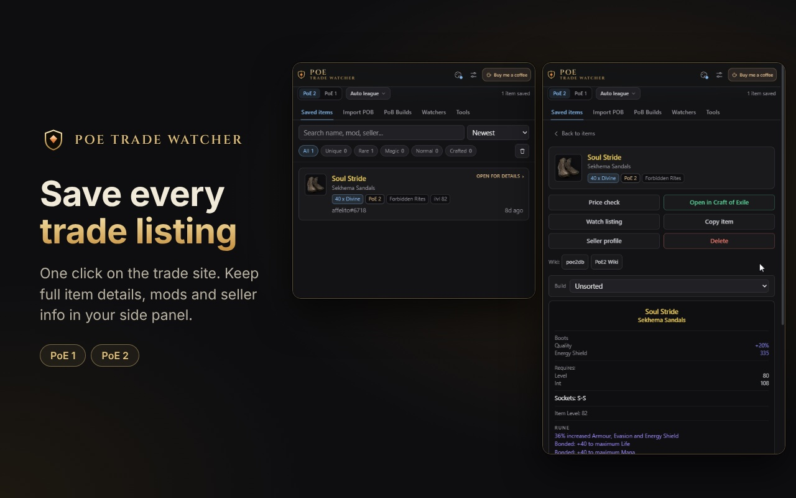
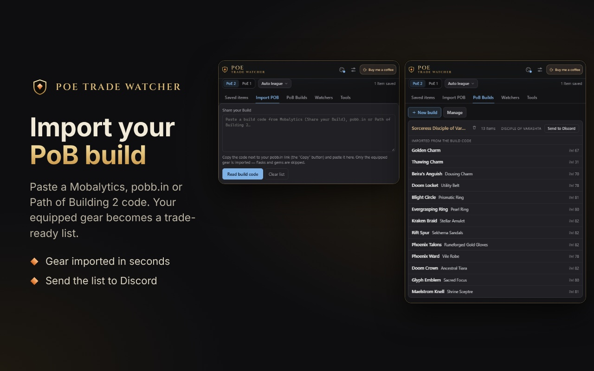
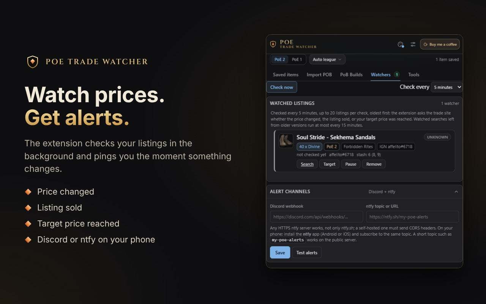
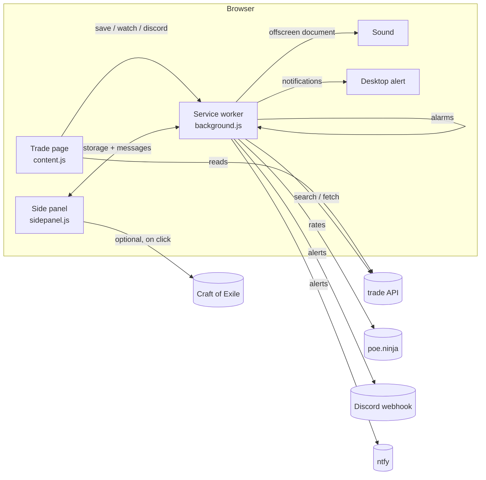

<div align="center">


# Poe Trade Watcher

**Save any Path of Exile 1 or 2 trade listing, keep it with every modifier and price, import your Path of Building gear, and get told the moment a price moves.**


<a href="#1-what-it-is"></a>

<sub><i>A saved listing in the panel, and the same item open with every modifier, its price history and one-click actions.</i></sub>

</div>

> [!NOTE]
> A fan-made helper, not affiliated with Grinding Gear Games. It reads the public
> trade site, so you need to be logged in there (or at least able to search) for
> the links it builds to work.

---

## Table of contents

1. [What it is](#1-what-it-is)
2. [At a glance](#2-at-a-glance)
3. [The trade page](#3-the-trade-page)
4. [The side panel](#4-the-side-panel)
   - [Header and context bar](#41-header-and-context-bar)
   - [Saved items](#42-saved-items)
   - [One item, in full](#43-one-item-in-full)
   - [Import POB](#44-import-pob)
   - [PoB Builds](#45-pob-builds)
   - [Watchers](#46-watchers)
   - [Tools](#47-tools)
   - [Settings](#48-settings)
5. [Alerts](#5-alerts)
6. [Games and leagues](#6-games-and-leagues)
7. [Craft of Exile import](#7-craft-of-exile-import)
8. [Search quality](#8-search-quality)
9. [Themes](#9-themes)
10. [Every setting, one table](#10-every-setting-one-table)
11. [Data, backups and sync](#11-data-backups-and-sync)
12. [Privacy and network](#12-privacy-and-network)
13. [Rate limits](#13-rate-limits)
14. [Architecture](#14-architecture)
15. [Install, develop, package](#15-install-develop-package)
16. [Tests](#16-tests)
17. [Troubleshooting](#17-troubleshooting)
18. [Known limitations](#18-known-limitations)
19. [Credits](#19-credits)
20. [Licence](#20-licence)

---

## 1. What it is

The Path of Exile trade site is a search engine: it finds listings, and the
moment you close the tab the listing is gone. Poe Trade Watcher turns it into a
collection:

- **one click saves a listing with everything** — every modifier, the runes in
  the sockets, the icon, the price, the seller, the stash position and the
  search that found it;
- **a side panel keeps them organised** next to the trade tab, in collections
  ("builds"), searchable by name, modifier or seller, with price history;
- **a background alarm re-checks what you watch** and tells you when a price
  drops, a listing sells, or your target price is hit — on the desktop, in
  Discord, or on your phone through ntfy;
- **builds come in from Path of Building** (pobb.in, Mobalytics or a raw code)
  as a gear list you can search for, and go out again as a Discord message;
- **one click sends an item to Craft of Exile**, with its modifiers, tiers and
  corruption state.

PoE 1 and PoE 2 are separate everywhere: separate leagues, separate trade
endpoints, separate item rules, separate saved searches. A bug or a choice in
one game never leaks into the other.

Everything is local. No account, no analytics, no server of its own.

---

## 2. At a glance

| Where | What you get |
| --- | --- |
| 🛒 **Trade page** | Save / Watch / Discord on every result row, live item meta, seller blacklist, scam flag, value badge, local filter, mod-colour legend, expired-search banner |
| 🗃️ **Saved items** | Every saved listing with full item data, search + 5 sorts + rarity chips, price history, fair price, one-click price check |
| 🔍 **Item details** | Price check, Open in Craft of Exile, Watch listing, Copy item, Seller profile, Delete, wiki chips, build assignment |
| 📦 **Import POB** | PoE 1 and PoE 2 build codes from Path of Building, pobb.in or Mobalytics, decoded on your device, gear preview before import |
| 🏗️ **PoB Builds** | One card per build with its gear, ascendancy, notes and goals, per-build Discord export, per-build delete |
| ⏰ **Watchers** | Price change / sold / target price / watched-seller alerts every 1–60 minutes, desktop notification + sound + Discord + ntfy |
| ⚒️ **Craft of Exile** | Item → Craft of Exile with base, quality, item level, every modifier with its tier, and the corrupted flag |
| 🎨 **Themes** | Six palettes, every text token above 4.5:1 contrast |
| 💾 **Data** | `chrome.storage.local`, JSON backup/restore, optional Chrome Sync with real quota handling |

---

## 3. The trade page

The content script runs on `pathofexile.com/trade/*` and `/trade2/*` and adds a
small action block to every result row. It follows the page: rows added by
pagination, by a new search or by the item popup are picked up as they appear.

### Row actions

| Button | What it does |
| --- | --- |
| **Save** | Stores the listing: full item JSON, icon, price and its conversion, seller, league, stash tab and position, the search that found it. Goes to *Unsorted* — a build is assigned on purpose, never guessed from the filter you happen to have open. The label becomes **Saved**. |
| **Watch** | Adds the listing to Watchers. The label becomes **Watching**. Watching from the page and watching from the panel are the same list. |
| **Discord** | Posts the item to your webhook as a formatted embed. Without a webhook, or if Discord refuses, the message is copied to the clipboard instead so nothing is lost. |

Every button reports what happened: a spinner while it works, the truth
afterwards, and a **20-second deadline** so a slow answer can never leave a
button stuck on "Saving…" or "Removing…" (2.9.49).

### What a row shows

- item level and quality;
- the seller and their character name (IGN), with the online state the API
  reports;
- stash tab and position, and the listing fee when there is one;
- the price converted to the currencies you chose (Divine, Exalted, Chaos);
- a **new** badge for listings under five minutes old;
- an **estimated value** badge — price per unit of quality in chaos orbs, lower
  is better — when the local price index can compare the item;
- a warning when the page and the API disagree about a listing (a stale row, or
  a DOM that changed under us);
- highlighted matched stats, so you can see *why* a result matched.

### Protections on the page

| Feature | Behaviour |
| --- | --- |
| **Blacklist** | Sellers on your blacklist are hidden from the results. Toggle in Settings. |
| **Seller alerts** | A desktop notification when a seller on your whitelist lists something new. |
| **Scam detection** | Flags suspiciously cheap listings (price mining): an item far below the median of comparable listings. |
| **Value sort** | Optional reordering of the page by value score, best first. |
| **Local filter** | An optional box that filters the rows already on the page by name, base, modifier or seller, with a count of what it hid. Off by default — the site's own search is the better place to narrow. |
| **Mod colours** | A legend explaining the site's modifier colours (implicit, explicit, crafted, fractured, desecrated, …), pinned under the header. |
| **Expired search** | A saved search the site no longer accepts shows a banner with *Open a fresh search* and *Dismiss* instead of an empty page. |
| **Rate-limit awareness** | While the trade API asks this IP to slow down, the row actions stop calling it and say so. |

---

## 4. The side panel

Five sections: **Saved items · Import POB · PoB Builds · Watchers · Tools**,
plus the settings screen behind the gear button.

<a href="#45-pob-builds"></a>

<sub><i>A build code in, a gear list out — ready to price-check item by item or send to Discord as one message.</i></sub>

### 4.1 Header and context bar

- The shield wordmark, a theme button (opens the palette picker), settings, and
  a Ko-fi support link.
- **PoE 2 / PoE 1 switch** — a two-way switch that changes the game for
  everything: league list, searches, item rules, watchers badge.
- **League pill** — the league used for searches of the active game, with the
  full list from the trade site; "Auto league" when you let it detect.
- **Saved count** — how many listings are in the collection.

### 4.2 Saved items

The default tab, and only listings saved from the trade site (imported gear
lives in PoB Builds and never mixes in).

| Control | What it does |
| --- | --- |
| Search box | Matches name, base type, modifier text and seller. |
| Sort | Newest · Oldest · Price (high → low) · Value (best first) · Name (A–Z). |
| Rarity chips | All · Unique · Rare · Magic · Normal · Crafted, each with a count. |
| Trash button | Deletes every saved listing but keeps builds and their imported gear, and leaves assigned builds intact. |

Each card shows the item icon, name, base type, price once (a conversion that
just repeats the price is dropped), game and league, the seller's IGN, and the
**seller's listing time** — "2h ago" is how old the offer is, not when you saved
it; the tooltip carries both dates. **Open for details** sits in the top-right
corner.

### 4.3 One item, in full

The detail view renders the item the way the game does — name, base, quality,
defences, requirements, sockets, runes, item level, every modifier with its
tier, and the price history — with these actions:

| Action | What it does |
| --- | --- |
| **Price check** | Opens the search the item was saved from, exactly as it was. If that search would not find the item again (the site's default search, or one with only a price filter), a search is built for the item instead: base type, rarity, item level, quality, corruption and its own modifiers, in the league it was saved from. If it cannot be built, it says why instead of opening a useless search. |
| **Open in Craft of Exile** | Sends the item to `beta.craftofexile.com`. A one-time explainer says what the site is, what to do there and what is *not* imported. |
| **Watch listing** | Same as Watch on the trade page. |
| **Copy item** | Copies the item as text (the same block the game copies). |
| **Seller profile** | Opens the seller's `pathofexile.com` profile. |
| **Delete** | Removes the listing from the collection. |
| **Wiki chips** | PoE2DB / PoE2 Wiki (or PoEDB / PoE Wiki for PoE 1), for the base type. |
| **Build** | Assigns the listing to a build, or back to Unsorted. |
| **Price history** | The prices you have seen for this item over time, plus the fair price from your own local index and a rough craft cost when Craft of Exile data is available. |

Corrupted items are shown as corrupted, imported into Craft of Exile as
corrupted, and coloured red in Discord.

### 4.4 Import POB

Paste a build code — from Path of Building, **pobb.in** or **Mobalytics** ("Share
your Build") — press **Read build code**, and the equipped gear appears as a
list. Then choose **Import into** a new build or an existing one, and press
**Import gear**.

- **Only equipped gear.** Flasks and gems are skipped; no item pictures are
  fetched for imported gear.
- **Every modifier line is kept**, not just explicit ones: crafted, fractured,
  desecrated and the rest, so a search built later is as precise as the import.
- **Decoded locally.** Pasting a code contacts no server and opens no build
  page; only the gear you import is saved.
- **Bounded on purpose.** A code is capped at 400,000 characters, and
  decompression runs in 64 KB chunks that abort the moment the output passes
  32 MB, so a decompression bomb from the internet cannot fill memory. zlib, raw
  deflate and gzip are all accepted.
- **Clear list** empties the pasted code and the preview without touching what
  you already imported.

### 4.5 PoB Builds

One card per build:

- **Name in gold**, the ascendancy with its icon, the game and the league.
- **Imported gear** listed with base type and item level; any item opens the
  same detail view as a saved listing ("Back to builds" returns).
- **Send to Discord** — title, ascendancy, one field per item with base, rarity,
  item level, league and its best rolls, split across messages inside Discord's
  limits.
- **Delete (per build)** — the imported gear goes with it, and any saved
  listings assigned to it fall back to Unsorted instead of disappearing.
- **Manage** — rename, delete and assign saved listings; **New build** creates
  one.
- **Notes and goals** — free-text notes and a checklist you tick yourself.
  A watched listing that disappears only sends an alert; it never ticks a goal,
  because "sold or removed" does not mean you bought it.

### 4.6 Watchers

<a href="#5-alerts"></a>

<sub><i>One watched listing, its status pill, and the two alert channels that carry it to your desktop, Discord or phone.</i></sub>

- **Check now** and a **Check every** selector (1, 2, 5, 10, 15, 30, 60
  minutes). The hint under the title states the real behaviour: up to 20
  listings per check, oldest first; watched searches left over from older
  versions run at most every 15 minutes.
- **Each watched listing** shows the item, base type, price, game, league,
  seller IGN, stash tab and position, how long ago it was checked, and a status
  pill: **available** (green), **price changed** (blue), **target reached**
  (warm), **sold** (red), **unknown** until the first check.
- **Per-listing buttons**: Search (re-runs the saved search), Target (set a
  target price and currency), Pause / Resume, Remove.
- **Watched searches** saved by older versions keep re-running their query and
  notifying about new listings, on the same 15-minute floor.
- **Alert channels** sit in a fold: Discord webhook and ntfy topic or URL, with
  **Save** and **Test alerts**. The same values live in Settings and stay in
  sync. Nothing is sent until you press Test or an alert fires.

### 4.7 Tools

Links to the author's other Path of Exile 2 tools, opened on GitHub: **Path of
Expedition** (Expedition price checker and planner) and **Chat Alert** (real-time
chat alerts for PoE 1 and 2).

### 4.8 Settings

Five fieldsets — **General**, **Results**, **Watchers**, **Data and privacy**,
**Sync and data** — with every option described in
[section 10](#10-every-setting-one-table). Theme and text size are live; the rest
is saved with **Save settings**, and a refused permission is reported *after*
saving instead of being hidden behind "Saved."

---

## 5. Alerts

A background alarm wakes the service worker on your interval. Each pass looks at
what is due, oldest first, and checks at most twenty listings — so with many
watchers they take turns instead of the first twenty being re-checked forever.

### What you are told

| Alert | When | Message |
| --- | --- | --- |
| **Price changed** | The listing's price changed | `Name - Base: old -> new` |
| **Watched item sold or removed** | The listing is gone from the API | `Name is no longer listed.` |
| **Target price reached** | The price is at or below the target you set | `Name: price (target X currency)` |
| **Watched seller listed** | A whitelisted seller has a new listing | Seller + item |

Flags behave: a listing that comes back after "sold" can announce a sale again,
and a price that climbs back above your target re-arms the target alert for the
next drop.

### Where it goes

| Channel | Notes |
| --- | --- |
| **Desktop notification** | Chrome notifications, behind the *Desktop notifications* switch (sold, price change and target all respect it). |
| **Sound** | Two short tones when a watched price changes, played in an offscreen document because a service worker cannot use Web Audio. At most one every five seconds; behind its own switch. |
| **Discord** | A webhook embed per alert: item name, base, old and new price, seller, league, and a red bar for corrupted items. Access to `discord.com` is requested the first time you save or test a webhook, never at install. Live-tested: HTTP 204. |
| **ntfy** | A plain POST to `https://ntfy.sh/<topic>` or to any HTTPS ntfy server of your own. Install the ntfy app on the phone and subscribe to the same topic. Live-tested: HTTP 200. A self-hosted server must send CORS headers, because without broad host permissions the browser contacts it directly; a failed test says so. |

> [!TIP]
> Alerts carry the item name, the price and the seller's character name. For
> ntfy on the public server, use a long random topic — a topic is a password:
> anyone who knows it can read it.

A refused Discord or ntfy permission is reported after saving, and a webhook or
address that cannot possibly work is refused at save time rather than silently
accepted.

---

## 6. Games and leagues

| | Path of Exile 2 | Path of Exile 1 |
| --- | --- | --- |
| Trade site | `pathofexile.com/trade2` | `pathofexile.com/trade` |
| Search / fetch API | `.../api/trade2/search` and `.../fetch` | `.../api/trade/search` and `.../fetch` |
| Trade status sent | `available` — measured on the live site: *Instant Buyout and In Person* | same |
| Icon lookups | `any` | `any` |
| Leagues | the list the trade site publishes | the list the trade site publishes |
| Item rules | PoE 2 modifiers, runes, quality | PoE 1 modifiers, sockets, links |

- A saved listing always searches the league **it was saved from**.
- An imported item searches the league picked in the header, then the typed
  fallback league, then the league of the open trade tab. The worker no longer
  pins Standard.
- The league pill and the settings league are per game, so switching games does
  not carry a league across.

---

## 7. Craft of Exile import

**Open in Craft of Exile** sends the item's `details` payload, which is what the
site's own import expects:

- base type, quality and item level;
- every modifier with its tier and its value ranges;
- the corrupted flag, so a corrupted item arrives corrupted;
- a two-number modifier ("Adds 32 to 68 Physical Damage") picks the tier whose
  ranges hold **both** numbers;
- desecrated modifiers are included by default (switchable), because a
  desecrated item is not the item without them.

**What is not imported, on purpose:**

- socketed **runes** — never imported, by choice;
- the base defence roll, which the site rolls itself;
- hybrid affixes the API prints on two lines can arrive split, because the site
  keeps one modifier per affix group;
- uniques arrive as their base type with quality and item level.

---

## 8. Search quality

Every search the extension builds follows the same rules, for both games:

- **base type goes in `type`, uniques in `term`** — a base in `term` returns
  nothing;
- **build-defining stats are required** (`and`), the rest match all but one
  (`count(n-1)`) with no roll minimums;
- a stat that appears twice on the item counts once;
- **runes are never searched**, in either game;
- prices are compared in the currency you chose, using the poe.ninja rates.

---

## 9. Themes

Six palettes on one token system; the dark ones are lifted out of near-black and
the light ones have a floor so cards are never white on white. Every text token
measures above 4.5:1.

| Theme | Mood |
| --- | --- |
| **Graphite** *(default)* | Neutral dark grey, gold accents |
| **Midnight** | Deep blue-black |
| **Ember** | Warm charcoal with ember orange |
| **Forest** | Dark green-black |
| **Daylight** | Clean light neutral |
| **Sand** | Warm light parchment |

The picker lives behind the palette button in the header; the gold logo turns
bronze on the light themes so it stays readable.

---

## 10. Every setting, one table

| Setting | Default | What it does |
| --- | --- | --- |
| Theme | Graphite | Palette, also in the header picker |
| Text size | Large | Small, Medium, Large, Extra large |
| League | Auto | Detect from the trade site, or pin one per game |
| Hardcore | off | Use the Hardcore variant of the league |
| Fallback league | empty | Used when no league can be detected for the active game |
| Price display | Divine + Exalted | Divine + Exalted, Divine, Exalted or Chaos |
| Show price conversions | on | poe.ninja conversion next to the price |
| Show seller IGN | on | Character name beside the seller |
| Highlight matched stats | on | Marks the stats that made a result match |
| Wiki links | on | PoE2DB / wiki chips on items |
| Include desecrated mods in Craft of Exile | on | Desecrated modifiers go to CoE too |
| Mod type next to P/S tiers | on | Shows crafted / fractured / desecrated next to tier labels on the trade page |
| Show a filter box on the trade page | **off** | The local filter over the rows already loaded |
| Show the fair price of a saved item | on | Median of comparable listings from your own index |
| Flag suspiciously cheap listings | on | Price-mining heuristic |
| Hide blacklisted sellers | on | Blacklist is applied to results |
| Blacklist | empty | One seller per line |
| Reorder page results by value score | off | Sorts the page by value, best first |
| Notify me about the sellers listed below | on | Watched-seller alerts |
| Seller alerts | empty | One IGN per line |
| Check interval | 5 minutes | 1–60 minutes for watchers |
| Desktop notifications | on | Sales, price changes, targets |
| Watcher sound | on | Two tones on a price change |
| Discord webhook | empty | Optional alert channel |
| ntfy topic or URL | empty | Optional alert channel, any HTTPS server |
| Sync settings with Chrome Sync | off | Pushes settings and the saved-search data older versions kept, never the item collection |

Buttons in the same screen: **Refresh** (league list), **Test alerts**, **Privacy
policy**, **Push sync**, **Pull sync**, **Download backup**, **Restore backup**,
**Delete all saved items**.

---

## 11. Data, backups and sync

- Everything lives in `chrome.storage.local`: saved listings, builds and their
  gear, watchers, price history, settings. The extension asks for
  `unlimitedStorage` because a normal collection outgrows Chrome's 10 MB default
  long before the cap on items (2,000 listings, 200 builds, 300 watchers) is
  reached.
- **Backup** writes one JSON file with items, builds, watchers, price history,
  the saved-search data older versions kept, and settings. **Restore** reads it
  back, sanitising everything it finds: names, games, goals, gear, ascendancy
  icons (only from the two item databases) and the list caps. Secrets are
  stripped from backups.
- **Chrome Sync** (optional) carries your settings and the saved-search data
  older versions kept — never the item collection — with the real quotas handled
  (100 KB in total, 8 KB per item), stale chunks removed and secrets stripped. A
  status line reports "Last pushed 7m ago · 3 chunks · 11 KB of 100 KB".
- **Delete all saved items** clears the collection but keeps builds, imported
  gear and settings.

---

## 12. Privacy and network

No accounts, no analytics, no telemetry, no server of its own. The full policy
ships with the extension in [privacy.html](privacy.html).

| Destination | When | What is sent |
| --- | --- | --- |
| `pathofexile.com` trade API | A search, a price check, a watcher tick | The query or the listing ids |
| `web.poecdn.com` | Showing an item | The icon path |
| `poe.ninja` | Price conversions and rates | Nothing but the request for the public rates |
| `beta.craftofexile.com` | You press *Open in Craft of Exile* (optional permission, asked at that click) | The item payload |
| `mobalytics.gg` | You ask it to read the build tab you have open (optional permission) | Nothing; it reads the page in your browser |
| `cdn.poe2db.tw`, `cdn.poedb.tw` | An ascendancy icon | The image request |
| `discord.com` / `discordapp.com` | Only with a webhook configured | Item name, price, seller, mods |
| `ntfy.sh` or your own ntfy server | Only with ntfy configured | The same alert text |

Host permissions are exactly those two trade/price hosts; everything else is an
**optional** permission requested at the moment you use the feature. There is no
broad host permission for self-hosted ntfy: the address you type is contacted
directly under CORS.

### Permissions explained

| Permission | What it is for | What it cannot do |
| --- | --- | --- |
| `storage` | Saved items, collections, builds, watchers and settings live in this browser profile | Nothing leaves the profile unless you configured Discord or ntfy |
| `unlimitedStorage` | Item artwork and build data go past the 10 MB default quota | It only lifts a size limit; no data is uploaded to make room |
| `alarms` | The watcher tick and the timed search watches still run with the panel closed | Wake anything but this extension |
| `notifications` | The desktop toast when a watched price changes | Read your notifications or send them |
| `scripting` | Reads the Mobalytics build tab **you already have open**, and only after you grant that optional host | Touch any tab on any other site |
| `sidePanel` | Puts the interface in the side panel | Read the page behind it |

`tabs` is deliberately **not** requested. The extension can see a tab's address
and title only on hosts it already has permission for, which is why it can find
your Mobalytics build tab once you allow that one host, and nothing else.

---

## 13. Rate limits

The trade API is rate-limited per IP, and the extension reads the headers it
sends back:

```
X-Rate-Limit-Ip:        8:10:60,15:60:120,60:300:1800,600:10800:3600
X-Rate-Limit-Ip-State:  1:10:0,1:60:0,1:300:0,17:10800:0
```

Each entry is *limit : window : penalty*. The extension:

- parses `X-Rate-Limit-Ip`, `X-Rate-Limit-Account` and their `-State`
  counterparts, plus `Retry-After`;
- takes the **longest** wait the signals imply, and paces the next request
  before sending it when a window is one request from full;
- keeps a persisted block when the site actually answers `429`, bounded between
  a floor and a ceiling, and still reads "wait N seconds" from the body as a
  fallback;
- spaces searches on its own (5 s between them, roughly twelve a minute) so a
  build import's ladder of filters never walks into the limit;
- stops the whole watch pass while a block is active — no request goes out at
  all — and saves the state of each watched search as it goes, then stops the
  pass after four minutes with the rest still due for the next tick, so a
  service worker being stopped mid-loop cannot cause duplicate alerts.

---

## 14. Architecture



| File | Role |
| --- | --- |
| `background.js` | Service worker: message router, storage schema and sanitisers, watcher loop and alarms, trade API calls, rate limiting, Discord/ntfy posting, backup and restore |
| `sidepanel.html/.css/.js` | The whole interface: five tabs, item detail, build cards, watcher cards, settings, modals, themes |
| `content.js` / `content.css` | Trade-page widgets: row actions, meta, filter, legend, blacklist, value badge, expired-search banner |
| `ptc-games.js` | Per-game profiles: endpoints, trade status values, league handling |
| `ptc-poe1.js` / `ptc-poe2.js` | Game rules: item classes, modifier text, search filters |
| `ptc-features.js` | Local price index: `fairPrice`, `valueRatio`, `scamFlags`, `craftCost` |
| `ptc-settings.js` | Settings schema, validation and defaults |
| `ptc-modtext.js` | Modifier text helpers |
| `item-utils.js` | Item parsing, price text, listing dates, Discord formatting |
| `coe.js` | Craft of Exile index and `details` payload |
| `pob-import.js` | Build code decoding (base64url + zlib/raw/gzip in chunks) and gear extraction |
| `ascendancies.js` | Ascendancy names and icons per game |
| `themes.css` | The six palettes |
| `viewer.html/.js/.css` | A standalone page that renders one saved item |
| `offscreen.html/.js` | The two-tone alert sound |
| `privacy.html/.css` | The shipped privacy policy |
| `tests/` | Three Node harnesses (see below) |

Keys for the newer features carry a `ptc` prefix (`ptcSettings`,
`ptcPriceIndex`, `ptcSearchWatches`), so a profile that already held the older
keys keeps working after an update.

---

## 15. Install, develop, package

**From source**

1. Open `chrome://extensions` and enable **Developer mode**.
2. **Load unpacked** → pick this folder.
3. Open `pathofexile.com/trade2` (or `/trade`) and the panel appears in the
   side-panel button.

There is no build step, no bundler and no dependency install: the files in the
repository are the extension. After editing, press **Reload** on the extension
card.

**Package for the store**

The store build is the extension files plus `fonts/`, `icons/`, `privacy.*` and
`themes.css`, packed into one `.zip`: no `tests/`, no docs, no backups. The
packages themselves are kept out of this repository.

**Minimum Chrome:** 116 (side panel API and the service-worker behaviours used
here).

---

## 16. Tests

No dependencies and no network. Each harness loads the real source into a small
`chrome` stub and runs against it.

```bash
node tests/run-tests.js     # 202 assertions
node tests/watcher-sim.js   #  70 assertions
node tests/search-sim.js    #  27 assertions
```

| Harness | Covers |
| --- | --- |
| `run-tests.js` | Game profiles, item and schema parsing, listing dates, Discord text, Craft of Exile payload, modifier tiers, build-code limits and the decompression bomb |
| `watcher-sim.js` | Worker cycles: price change, sold, target reached, one-time flags, watcher ordering, incremental search-watch saving, rate-limit headers, build export, build delete, restore sanitising |
| `search-sim.js` | Search rules: rune exclusion, required vs optional stats, leagues, the trade status value |

---

## 17. Troubleshooting

| Symptom | Cause and fix |
| --- | --- |
| No buttons on the trade page | The extension was reloaded while the tab was open — refresh the trade tab. |
| "Wait N seconds" notice | The trade API is rate-limiting this IP. The extension waits it out and resumes by itself. |
| Alerts never arrive | Press **Test alerts** in Watchers → Alert channels. A refused permission is reported there; allow it and save again. |
| Discord test fails | The webhook was deleted in Discord, or `discord.com` access was refused. |
| ntfy test fails on your own server | It must answer with CORS headers; `ntfy.sh` does. |
| A target alert does not repeat | By design: it fires once, and re-arms only after the price goes back above the target. |
| Panel shows another league | The league is per game; check the pill in the context bar. |
| Search finds nothing after a league change | Saved listings search the league they were saved from; start a new search in the current league. |

---

## 18. Known limitations

- **Craft of Exile:** runes are not imported (by choice), the base defence roll
  is rolled by the site, hybrid affixes printed on two lines can arrive split,
  and uniques import as their base with quality and item level.
- **Build imports:** only equipped gear — no flasks, no gems, no jewels in the
  passive tree.
- **Watched searches** cannot run more often than every 15 minutes, because each
  check is a real search on the trade site.
- **Price history and fair price** are built only from the listings you have
  seen; they are a local estimate, not a market index.
- **Old backups** are sanitised on restore: anything unrecognised, unbounded or
  from an unknown host is dropped rather than trusted.

---

## 19. Credits

- **Cinzel** for the wordmark, bundled locally under the SIL Open Font Licence
  (`fonts/OFL-Cinzel.txt`).
- **pako** for zlib in the build-code decoder (`pako.min.js`).
- Item and ascendancy artwork from the official CDNs and **PoE2DB** / **PoEDB**.
- Build codes and gear data from **Path of Building**, **pobb.in** and
  **Mobalytics**.
- Price data from **poe.ninja**; crafting from **Craft of Exile**.
- Path of Exile is a trademark of Grinding Gear Games. This project is
  unofficial and not endorsed by them.

---

## 20. Licence

**MIT** — see [LICENSE](LICENSE). Use it, change it, ship it; keep the copyright
notice.

The name and the shield icon identify this project; if you publish a modified
build, give it your own name and icon so users know which one they have.
